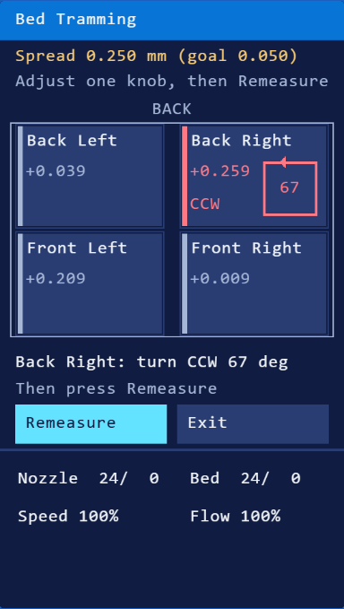
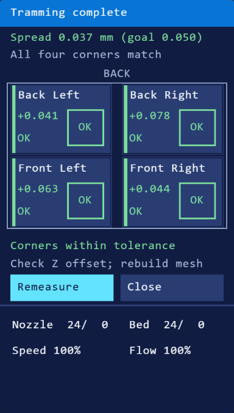
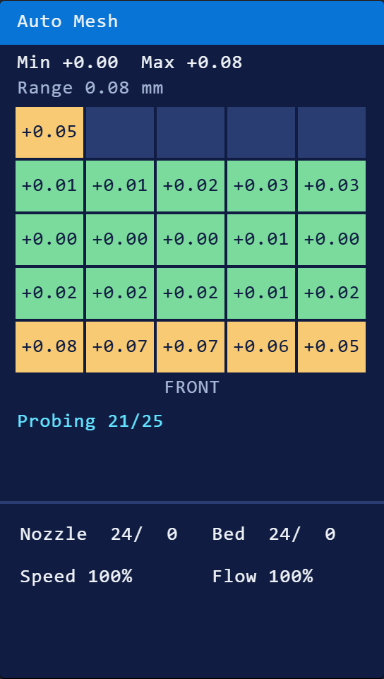

# JNPCREATES Ender-3 V2 Neo Tramming Firmware

Bed leveling made easy for the **Creality Ender-3 V2 Neo** (V4.2.2 board, CR Touch). Built on Marlin 2.1.2.9.

  
  
  

## What's added

- **Bed Tramming:** probes the four corners and tells you **one knob at a time**: which one, which way and how many degrees. Repeat until all four are green.
- **Auto Mesh 5×5:** watch the mesh fill in live. It's saved automatically. **View Mesh** shows it any time.
- **Paper Leveling:** moves the nozzle over each knob for the paper test.
- **Probe Accuracy Test:** checks your CR Touch.

## How to install

### 1. Check your screen and update it

This firmware was made and tested on a **TJC screen**. TJC screens need a one-time display update first.
Follow MRiscoC's guide to find out which screen you have and to update it: **[How to update the display](https://github.com/mriscoc/Ender3V2S1/wiki/How-to-update-the-display)**.

### 2. Flash the firmware

1. Download **[JNPCREATES-E3V2Neo-v1.0.bin](JNPCREATES-E3V2Neo-v1.0.bin)**.
2. Copy it to a FAT32 microSD card (32 GB or less) and **rename it** to a name you haven't flashed before.
3. With the printer off, insert the card and turn it on. After 10–30 seconds the screen shows **JNPCREATES**.

Everything should be the same setup except for the leveling option, which adds more features

Make sure to backup or note down your Z-offset, E-steps, and Homing Offsets.
Run Tramming guide and then run automesh to save the bed mesh into your system.

## Credits

Built on [Marlin](https://github.com/MarlinFirmware/Marlin). 
Inspired by MRiscoC's Professional Firmware. https://github.com/mriscoc/Ender3V2S1 \
I would recommend checking this github repo out first, there are multiple videos out there showing the setup process and it has way more features.\
I just wanted a quick tramming setup and this works well for my use case.\
Source changes: [`JNPCREATES-Marlin-2.1.2.9.patch`](JNPCREATES-Marlin-2.1.2.9.patch). License: GPL-3.0 ([LICENSE](LICENSE)).
